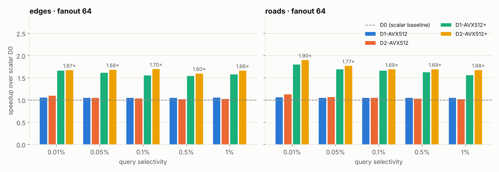
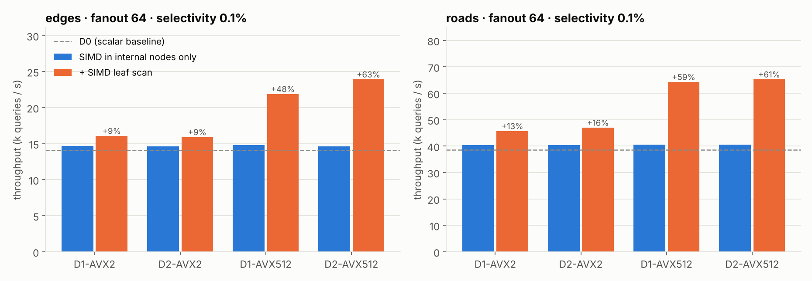
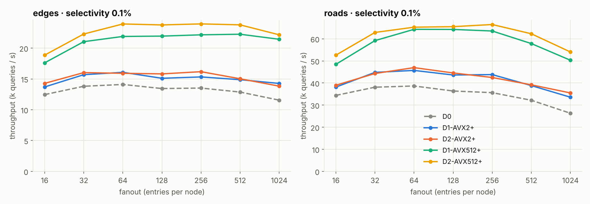

# SIMD-accelerated R-tree range queries

Vectorized spatial-select queries on an in-memory R-tree with **AVX2** and **AVX-512**,
comparing three node memory layouts. This is my Diploma Thesis at the University of
Ioannina (Dept. of Computer Science & Engineering, supervisor: Prof. Nikos Mamoulis, 2025).
It implements and evaluates the ideas of:

> Y. Rayhan and W. G. Aref. *SIMD-ified R-tree Query Processing and Optimization.*
> ACM SIGSPATIAL 2023.

**Headline result.** On real TIGER data (17M–51M points), the best configuration,
**D2 layout + AVX-512 in both internal nodes and leaves**, answers range queries
**1.6–1.9× faster** than a classic scalar R-tree. It executes **44% fewer instructions**
and has **~93% fewer branch mispredictions**.

📄 Thesis (Greek): [`docs/thesis_el.pdf`](docs/thesis_el.pdf) · Slides: [`docs/presentation_el.pdf`](docs/presentation_el.pdf)

---

## The idea

A range query has to check its rectangle against every child MBR of a visited node. A
scalar test checks one child at a time and needs four data-dependent branches. With the
right memory layout, one SIMD instruction compares one coordinate of **8 (AVX2) or 16
(AVX-512) children at once**. The comparison results combine into a bitmask that says
which children to visit.

```
D0  Array of Structures (classic)        one child = (lx, ly, hx, hy, ptr) stored together
    [lx ly hx hy ptr][lx ly hx hy ptr][lx ly hx hy ptr] ...

D1  Structure of Arrays                  one vector load = 8 / 16 values of the same field
    min_xs: [lx lx lx ...]  min_ys: [ly ly ...]  max_xs: [hx hx ...]  max_ys: [hy hy ...]  children: [...]

D2  Interleaved pairs                    2 loads + 2 compares per group
    lo: [lx ly lx ly lx ly ...]          hi: [hx hy hx hy hx hy ...]                       children: [...]
```

In D2 the query is broadcast as `(qminx, qminy, qminx, qminy, …)`, so one comparison
checks x and y at the same time. Each child gets two bits in the mask, and it intersects
the query only when both of its bits are set. From [`src/D2/D2_512_plus.cpp`](src/D2/D2_512_plus.cpp):

```cpp
__m512 lo_vec = _mm512_loadu_ps(&inner->lo[2 * i]);
__m512 hi_vec = _mm512_loadu_ps(&inner->hi[2 * i]);

__mmask16 cmp1 = _mm512_cmp_ps_mask(hi_vec, query_mins, _CMP_GE_OQ);  // hx >= qminx, hy >= qminy
__mmask16 cmp2 = _mm512_cmp_ps_mask(lo_vec, query_maxs, _CMP_LE_OQ);  // lx <= qmaxx, ly <= qmaxy
__mmask16 bitmask = cmp1 & cmp2;

if ((bitmask & 0x3) == 0x3) q.push(inner->children[i]);      // child 0: bits 0-1
if ((bitmask & 0xC) == 0xC) q.push(inner->children[i + 1]);  // child 1: bits 2-3
...
```

All trees are bulk-loaded with **STR (Sort-Tile-Recursive)** and traversed breadth-first
with a queue. The **`_plus`** ("+") variants also vectorize the final step, the check of
the points inside the leaves.

## Results

Measured on an Intel Core i7-11700K (AVX-512), 128 GB RAM, Ubuntu 22.04, GCC 13
`-O3 -march=native`. Each run executes 10,000 range queries. The raw numbers are in
[`results/thesis/`](results/thesis/).

### Speedup over the scalar baseline (D0)



| fanout 64 | 0.01% | 0.05% | 0.1% | 0.5% | 1% |
|---|---|---|---|---|---|
| Edges: D1-AVX512 / D2-AVX512 | 1.05× / 1.10× | 1.05× / 1.05× | 1.05× / 1.04× | 1.05× / 1.02× | 1.05× / 1.02× |
| Edges: D1-AVX512+ / **D2-AVX512+** | 1.66× / **1.67×** | 1.61× / **1.68×** | 1.55× / **1.70×** | 1.54× / **1.60×** | 1.58× / **1.66×** |
| Roads: D1-AVX512 / D2-AVX512 | 1.06× / 1.13× | 1.05× / 1.07× | 1.05× / 1.05× | 1.05× / 1.03× | 1.05× / 1.02× |
| Roads: D1-AVX512+ / **D2-AVX512+** | 1.80× / **1.90×** | 1.69× / **1.77×** | 1.66× / **1.69×** | 1.62× / **1.69×** | 1.56× / **1.68×** |

### SIMD in the leaves is what unlocks the speedup

Vectorizing only the internal nodes gains about 5%, because the scalar point-by-point
leaf check dominates the running time. Vectorizing the leaves as well adds **+48–63%**
with AVX-512. After that, the more compact D2 layout pulls slightly ahead of D1.



### Choosing the fanout

Throughput peaks at a fanout of roughly 64–256. Smaller nodes make the tree taller,
which means more pointer chasing. Larger nodes waste comparisons inside each node.



### Hardware counters (Edges, fanout 64, selectivity 0.1%)

| Variant | Cycles | Instructions | Branch misses | L1 refs | L1 misses |
|---|---|---|---|---|---|
| D0 (scalar) | 357K | 581K | 1,865 | 213K | 8,259 |
| D1-AVX2+ | 322K | 476K | 173 | 89K | 8,139 |
| D2-AVX2+ | 315K | 483K | 131 | 98K | 8,077 |
| D1-AVX512+ | 218K | 329K | 206 | 73K | 8,167 |
| **D2-AVX512+** | **211K** | **324K** | **128** | **73K** | **8,054** |

The full table for both datasets is in [`results/thesis/perf_counters.csv`](results/thesis/perf_counters.csv).

**Why not the 4× of the paper?** The paper also hides last-level-cache misses with
software prefetching (its "O2" optimization). This implementation does not include it,
so that is the natural next step.

## Code

Every variant is a self-contained C++ program, so you can read each one top to bottom:

```
src/
  D0/D0.cpp                       scalar baseline, AoS nodes
  D1/D1_256.cpp, D1_512.cpp       D1 layout, AVX2 / AVX-512 in internal nodes
  D1/D1_256_plus.cpp, ...         + SIMD in the leaves
  D2/D2_256.cpp, D2_512.cpp       D2 layout, AVX2 / AVX-512 in internal nodes
  D2/D2_256_plus.cpp, ...         + SIMD in the leaves
  BruteForce/bruteForce.cpp       linear scan, used to verify the results
scripts/
  run_all.py        compile all variants, run fanouts x query files -> CSV + figures
  plot_results.py   figures from a results CSV
  gen_data.py       synthetic points + queries (if you don't have the TIGER data)
data/queries/tiger/ the 5 query sets used in the thesis (10,000 queries each)
results/thesis/     thesis measurements (throughput, perf counters)
results/figures/    the figures above
docs/               thesis and slides (Greek)
```

| File | Internal nodes | Leaves |
|---|---|---|
| `D0` | scalar | scalar |
| `D1_256`, `D2_256` | AVX2 (8 floats) | scalar |
| `D1_512`, `D2_512` | AVX-512 (16 floats) | scalar |
| `D1_256_plus`, `D2_256_plus` | AVX2 | AVX2 |
| `D1_512_plus`, `D2_512_plus` | AVX-512 | AVX-512 |

## Build and run

You need GCC (or Clang) on an x86-64 CPU. The AVX-512 variants need a CPU with AVX-512F.
On Windows, use MinGW-w64 (MSYS2) or WSL. With MinGW, add `-Wa,-muse-unaligned-vector-move`
to the compile command (GCC on Windows mis-aligns AVX values on the stack), and keep the
repository in a folder whose path has only Latin characters, or use `run_all.py`, which
works around non-ASCII paths.

```bash
g++ -O3 -march=native -o D2_512_plus src/D2/D2_512_plus.cpp
./D2_512_plus <fanout> <points.csv> <unused_output> <queries.qry>
# e.g.
./D2_512_plus 64 roads_points.csv out.txt "data/queries/tiger/USA_c0.1%_n10000.qry"
```

```
Fanout: 64
Input File: roads_points.csv
Query File: data/queries/tiger/USA_c0.1%_n10000.qry
Total Elapsed Time: 290.99 ms
Total Matched Points: 97192279
```

Input formats: points are one `x,y` per line. Queries are one `min_x min_y,max_x max_y`
per line. The datasets are the centroids of the TIGER **Edges** (≈51M points) and
**Roads** (≈17M points) collections from [SpatialHadoop](https://spatialhadoop.cs.umn.edu/datasets.html).

To run the full experiment grid:

```bash
python scripts/run_all.py --data roads_points.csv --queries "data/queries/tiger/*.qry"
# no TIGER data? generate a synthetic set first:
python scripts/gen_data.py --points 2000000 --out data/synthetic        # needs numpy
python scripts/run_all.py --data data/synthetic/points.csv --queries "data/synthetic/*.qry"
```

`run_all.py` skips variants that your CPU cannot run. It also checks that every variant
returns the same number of matched points.

### Changes since the thesis version

These are small fixes. The algorithms and data structures are unchanged:

- **D1 variants:** the last group of children in a node can have fewer than 8 or 16
  entries. That group is now checked with scalar code instead of a vector load that
  read past the end of the arrays. The D2 variants already did this.
- **Timing:** the per-query timer uses nanoseconds instead of whole microseconds. The
  fastest queries take only a few microseconds, so truncating to whole microseconds was
  a large relative error.
- **Verification:** every program prints `Total Matched Points`. All variants and
  `bruteForce` print the same value: 97,192,279 on Roads at 0.1%.

## Possible extensions

- Software prefetching of queued nodes (the paper's O2 optimization).
- Store the leaf points as separate `x[]` / `y[]` arrays, so the "+" variants can load
  them directly instead of copying them into temporary arrays.
- Vectorize the other spatial operators: k-NN and spatial join (the paper reports up to 9× for joins).

## Author

**Eleftherios Marios Manikas** · Dept. of Computer Science & Engineering, University of Ioannina

## License

Code: MIT (see [LICENSE](LICENSE)). The thesis and slides in `docs/` are © the author.
